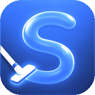
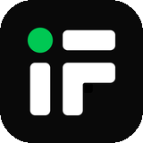

### Hi, I'm Kerem

Software engineer in Türkiye. I build products end to end and take them to market: backend, web, mobile, and the AI inside them. Since 2022 I have worked fully remote with companies in the US and Europe, as their CTO or lead engineer.

### What I'm building

<table>
<tr>
<td width="72"></td>
<td><b><a href="https://openline.com">Openline</a></b> · CTO 
Travel eSIMs for 200+ countries, sold directly to travelers. I lead engineering: the store, the apps, the provisioning behind every activation, and the AI support agent that resolves customer issues on its own. Next up is B2B, built on AI-driven workflows that keep costs and commissions low.</td>
</tr>
<tr>
<td></td>
<td><b><a href="https://boothieapp.com">Boothie</a></b> · Co-founder 
An AI photo app that turns a selfie into a film camera, digicam or photobooth shot. Built with my partner, grown by word of mouth, and a six-figure business within months of launch.</td>
</tr>
<tr>
<td></td>
<td><b><a href="https://swipezyapp.vercel.app">Swipezy</a></b> · Co-founder 
A photo and storage cleaner for iPhone and Android. Swipe through your library month by month, let on-device smart clean find duplicates, screenshots and blurry shots, and free up space. Nothing leaves your phone. Native Swift and Kotlin. Launching soon.</td>
</tr>
<tr>
<td></td>
<td><b><a href="https://lawindex.com.tr">LawIndex</a></b> · Founder 
Legal software in Türkiye was expensive and sold in pieces. LawIndex gives solo lawyers the whole toolkit in one place: case law search across hundreds of thousands of decisions, an AI assistant that cites its sources, drafting, and practice management.</td>
</tr>
<tr>
<td></td>
<td><b><a href="https://istfin.com">ISTFIN</a></b> · Co-founder &amp; CTO 
Live market data and algorithmic trading for Borsa Istanbul, from the exchange feed to the investor's screen. We take the live feed on our own servers in a data center, turn it into charts, screeners and signals in real time, and let investors design and backtest strategies and run them on paper. The same data is open to developers and AI agents through a public API and an MCP server.</td>
</tr>
</table>

### Things I made because I wanted them

<table>
<tr>
<td width="72"></td>
<td><b><a href="https://github.com/keremcanseker/seshat">Seshat</a></b> 
Read your docs better and share them with one click. A macOS reader that makes markdown read like a book, and a share link for any file. <a href="https://seshat.page">seshat.page</a></td>
</tr>
<tr>
<td></td>
<td><b><a href="https://github.com/keremcanseker/monocode">MonoCode, ported to the web</a></b> 
I took a desktop app for running AI coding agents and brought it to the browser, so I can steer, fork and review my agents from any device. It is how I work every day.</td>
</tr>
<tr>
<td></td>
<td><b><a href="https://github.com/keremcanseker/yaz">yaz</a></b> 
A minimalist writing app for macOS. Tabs, plain markdown files, a soft key sound, nothing to configure. <i>yaz</i> means "write".</td>
</tr>
<tr>
<td></td>
<td><b><a href="https://github.com/keremcanseker/deadly-dream">Deadly Dream</a></b> 
A comic-style murder mystery for iPhone. Read the panels, question the suspects, find the killer.</td>
</tr>
</table>
